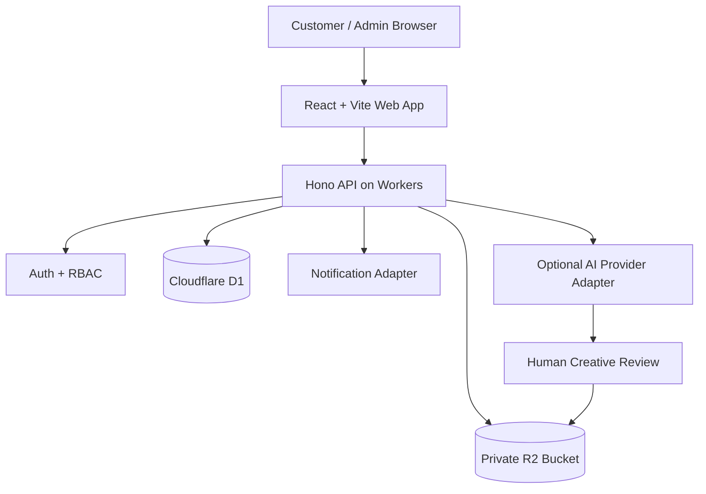

# 05 — Technical Architecture

> **Status note (2026-11-01):** Target architecture. As implemented: React SPA + Hono on Cloudflare **Pages Functions** (ADR-006), D1 in production. **R2 private storage is coded but not provisioned** (owner approval pending, ADR-008; see docs/41). Preview deployments have no database (docs/40).

## Architecture goal
Deliver a secure, inexpensive, maintainable service portal. Keep AI provider integrations optional and replaceable. Start with a modular monolith, not microservices.

## Proposed stack
- Frontend: React + Vite + TypeScript.
- API: Hono + TypeScript on Cloudflare Workers.
- Database: Cloudflare D1 (SQLite).
- Private files: Cloudflare R2.
- Authentication: secure admin authentication first; customer project access can begin with verified email magic links or high-entropy expiring access tokens. Select a provider only after validating free-tier and integration requirements.
- Hosting: Cloudflare Pages for frontend and Workers for API (or a Pages Functions deployment if operationally simpler).
- Validation: Zod or equivalent schema validation.
- Testing: Vitest; API integration tests against a local/test D1 binding.
- Observability: structured, redacted logs and platform metrics.

## Logical components
1. Web app — public pages, inquiry flow, customer project view, admin console.
2. API — validation, authorization, project lifecycle, signed upload/download authorization.
3. Domain services — inquiry, quote, project, asset, feedback, notification.
4. Persistence — D1 records and audit events.
5. Asset storage — R2 private bucket; no public bucket for customer uploads.
6. Provider adapters — optional generation/editing integrations; human-operated production is supported without API access.
7. Notification adapter — email or configured channel, with delivery state tracked.

## Request flow
Browser → API validation → authorization → D1 transaction → private asset storage where needed → notification adapter → response.
Production work is human-in-the-loop. An admin may trigger an optional provider adapter, but provider credentials remain server-side.

## Deployment environments
- Local development with Wrangler and local D1.
- Preview environment with isolated database and bucket.
- Production with separate D1 database, R2 bucket, secrets and allowed origins.
Never point preview deployments at production customer data.

## Security boundaries
- Browser never receives provider API keys, R2 credentials or service tokens.
- Admin routes require server-side role checks.
- Asset access requires project authorization and short-lived signed URLs or an authenticated download proxy.
- Apply request size limits, rate limiting and spam controls.
- Validate MIME type and file signature; do not trust file extensions.
- Avoid storing unnecessary personal data.

## Cost discipline
Begin with D1 + R2 and no queue unless workload requires asynchronous tasks. Avoid paid generation APIs until usage rights, pricing, latency and quality are verified. Track cost per project.

## Scaling path
- Add Cloudflare Queues for asynchronous jobs/notifications when needed.
- Add Durable Objects only for real-time collaboration or coordination needs.
- Add payment integration only after provider credentials, fees, settlement and webhook behavior are verified.
- Split services only when independent scaling or ownership justifies it.

## Architecture diagram

